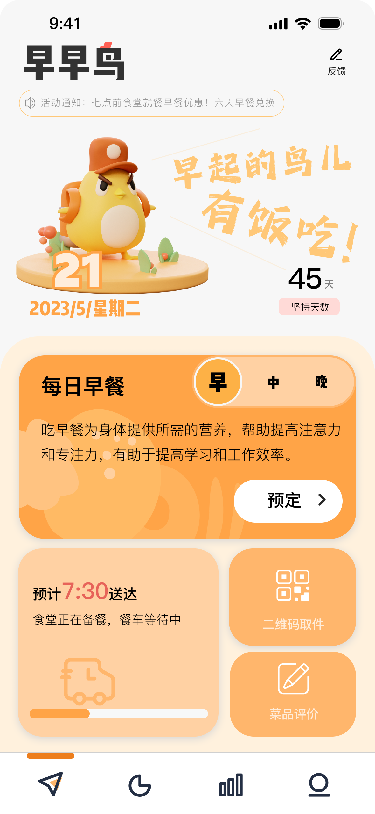
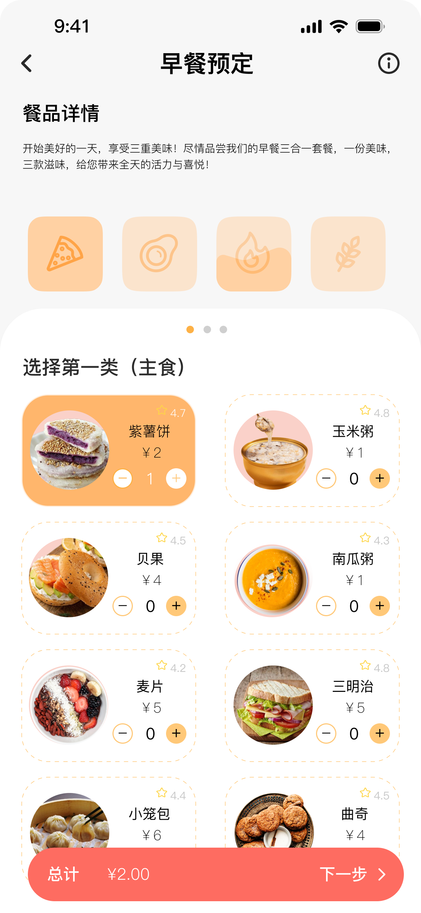
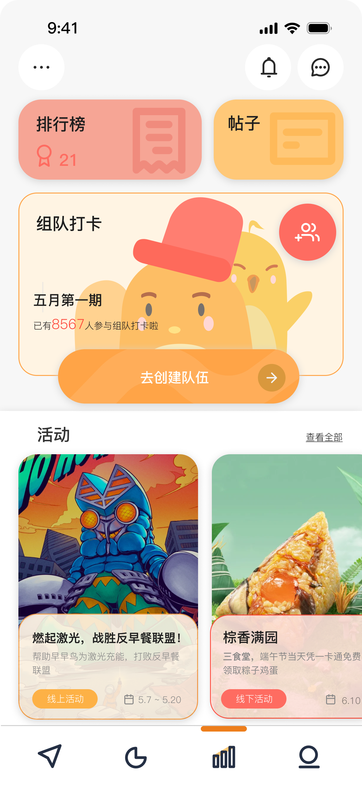

# 早早鸟 Early Bird

把一份早餐、一次早起和一点健康记录，变成温暖的校园日常。

早早鸟是面向校园早餐与健康生活场景的可交互前端演示。设计以暖橙色、奶油色、圆润卡片和早早鸟形象传达轻松、亲切的陪伴感，将早餐预约、食谱计划与组队打卡连接起来。

- 项目仓库：https://github.com/yuanzongyi22-zoey/early-bird
- 在线演示：https://yuanzongyi22-zoey.github.io/early-bird/
- 自动部署：推送 `main` 后，GitHub Actions 先测试、检查类型、构建，再发布 GitHub Pages。链接是否已经上线以仓库 Actions 的部署结果为准。

## 体验方式

点击欢迎页 → 登录（演示入口，无需账号）→ 首页「预定」→ 增减餐品 → 下一步 → 修改取餐时间或地点 → 结算 → 模拟取餐完成 → 评价本次早餐。

也可以通过底部导航浏览食谱、社区与个人页面：

- 早餐：8 种示例餐品、数量和金额计算、未来七天内预约、历史订单与评价。
- 食谱：切换早餐计划，应用推荐搭配，查看餐食与健康相关画板。
- 社区：创建或加入本机演示队伍、每日打卡、活动参与记录、示例排行榜。
- 健康：饮水记录、当日体重更新与近期记录。
- 反馈：保存本机建议，存储异常时给出提示并继续体验。

## 设计素材与界面预览

<p>
  
  
  
</p>

以上为项目自带的设计画板预览，不是浏览器运行截图。仓库包含 24 张 PNG：欢迎与登录、首页、食谱与计划、点单与订单、健康、社区、排行榜、活动、评价，以及品牌形象与 banner。

运行界面采用 393 × 852 的统一画板坐标，图片与可点击热点随窗口等比缩放；表单、数量、订单和记录由 React 生成。保留素材原有文件名，包括「登录也.png」。素材来自本项目提供的本地文件，未核验其原始 Figma 链接或第三方授权，本仓库不声明这些素材为开放许可。

## 技术栈

Next.js 15 App Router、React 18、TypeScript、CSS Modules；Vitest 5、Testing Library 与 jsdom 测试；GitHub Actions + GitHub Pages 静态部署。无数据库、服务端接口或第三方 API Key。

## 安装、运行、构建与测试

使用 Node.js 22.12+ 或 Node.js 24 LTS（完整版本范围见 package.json）。

```bash
git clone https://github.com/yuanzongyi22-zoey/early-bird.git
cd early-bird
npm ci
npm run dev
```

打开 http://localhost:3000/early-bird/ 。

```bash
npm test
npm run build
npm run typecheck
```

构建输出为 `out`，部署时挂载至 `/early-bird/`。这是静态导出项目，不使用 `next start`。开发缓存 `.next-dev` 与生产构建 `.next` 分离。

测试覆盖预约到评价闭环、食谱切换、活动去重、组队与重复打卡、健康记录、损坏和不可用的 localStorage、过期时间与空订单拦截，以及不同窗口尺寸的画板和热点缩放。

仓库还提供 `scripts/smoke.mjs`，用于真实 Chrome 冒烟。需另行准备 Playwright 与本机 Chrome；可通过 `PLAYWRIGHT_MODULE` 指定已有 Playwright 模块的绝对路径，再执行 `node scripts/smoke.mjs`。默认临时启动本地静态服务并测试构建产物；设置 `SMOKE_URL=https://yuanzongyi22-zoey.github.io/early-bird/` 可验证线上页面。脚本使用隔离浏览器上下文，验证订单评价与刷新恢复、打卡、健康记录、四种窗口尺寸，以及 24 张 PNG 和 JS/CSS 请求。

## 目录

```text
app/                    页面入口、布局、元数据与全局样式
src/EarlyBirdApp.tsx     画板导航、交互状态、存储校验和功能页面
src/early-bird.module.css 组件与画板样式
src/EarlyBirdApp.test.tsx 交互与数据边界测试
src/test/               测试初始化
scripts/smoke.mjs        本地与线上真实 Chrome 冒烟
public/early-bird/       24 张设计 PNG
.github/workflows/      测试、构建、Pages 发布流程
next.config.mjs         静态导出与 /early-bird basePath
package-lock.json       可复现安装的依赖锁
```

## 演示数据与服务边界

所有用户操作仅存储在当前浏览器的 `localStorage`，键为 `early-bird-demo-v1`。清除站点数据、更换设备或浏览器后，记录不会同步。存储空间不足或浏览器禁用存储时仍可操作，但可能仅在本次页面打开期间保留。

登录和注册不建立真实账号；订单、付款、配送、取餐码、组队、活动报名、消息与反馈不连接商家、柜机、客服或其他用户。健康记录不上传，食谱不是医疗建议。画板内的头像、榜单、积分、价格与健康指标为示例内容，不全部随本机记录变化。

知识库问答、聊天室、偏好设置等入口使用本地记录弹层；收藏按钮仅显示反馈，不提供完整收藏服务。部分健康相关入口复用健康记录页面。当前是设计与交互演示，不是可直接运营的校园订餐系统。

如需重置演示，可在该站点的浏览器控制台执行：

```js
localStorage.removeItem('early-bird-demo-v1')
location.reload()
```
